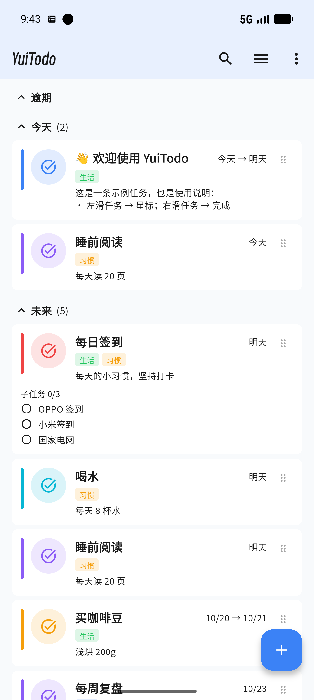
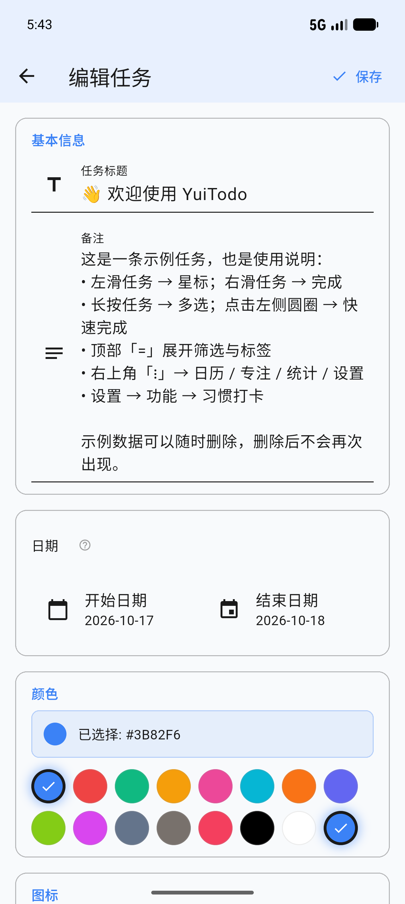
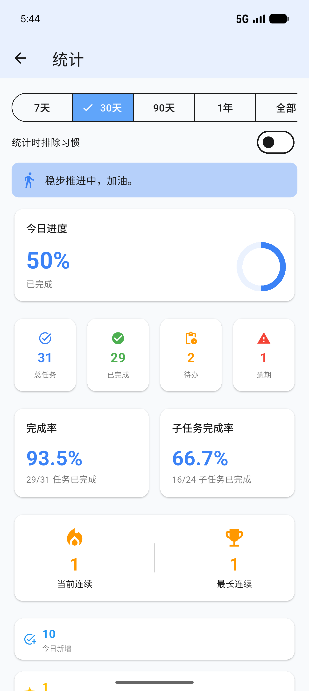
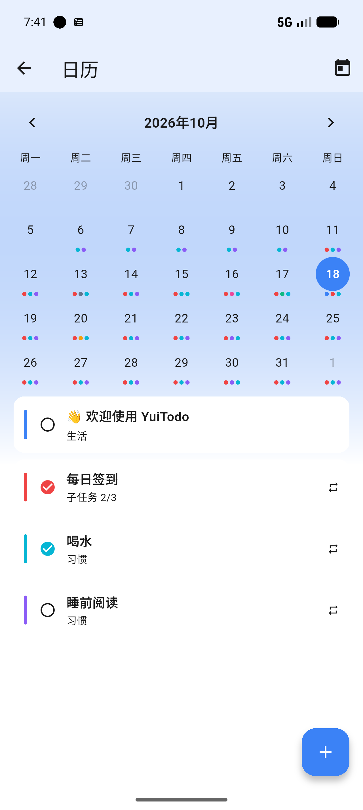
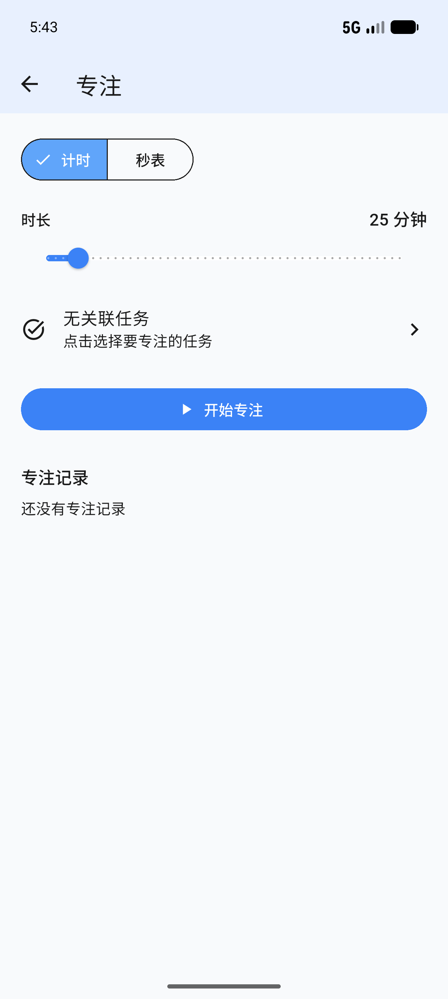
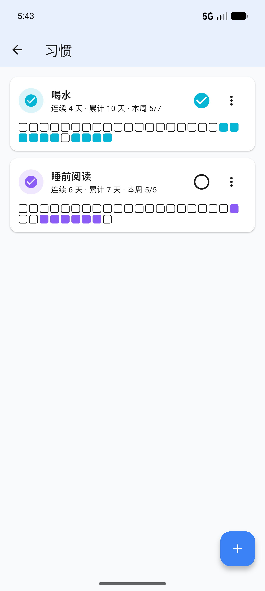

# YuiTodo

<div align="center">


**一款使用 Flutter 开发、纯本地、无账号的任务管理应用**

[下载 APK](https://github.com/CyberYui/YuiTodo-Flutter/releases) · [功能介绍](#功能介绍) · [如何使用](#如何使用) · [开发](#开发)

<!-- 截图展示区 -->
<table align="center">
<tr>
<td align="center"><br/><b>主页分区</b></td>
<td align="center"><br/><b>任务编辑</b></td>
<td align="center"><br/><b>统计面板</b></td>
</tr>
<tr>
<td align="center"><br/><b>日历视图</b></td>
<td align="center"><br/><b>专注模式</b></td>
<td align="center"><br/><b>习惯追踪</b></td>
</tr>
</table>

</div>

---

## 📖 设计背景

YuiTodo 诞生于对现有任务管理工具的不满：要么功能过于复杂，要么设计过于简陋。我在深度使用 Sorted 软件之后，发现 Android 平台上并没有类似的追求**简约而不简单**的设计理念应用，因此借助当今火热的 AI 工具，打造了一款自用的任务管理应用，它遵循下面几个特点：

- **视觉舒适**：iOS + Notion 混合风格，低对比度柔和配色
- **操作流畅**：手势优先，减少点击层级
- **功能完备**：覆盖任务管理的核心场景，无冗余功能
- **隐私优先**：纯本地存储，零网络请求，无账号、无云同步

---

## 🆕 v4.3.0 新变化

- **习惯 7/30/90 天网格**：习惯卡片顶部可切换历史窗口，连续天数/累计/本周不受影响。
- **日历周起始日**：设置 → 日历 → 每周起始日（周一/周日），日历列顺序随之调整。
- **静态检查清零**：115 条 warning/info → 0；替换弃用 API（withValues / RGB 访问器 / onReorderItem），清理未使用导入/代码，不改变功能。

---

## 🆕 v4.2.1 热修复

- 修复「稍后 10 分钟」后台更新数据库时误关闭 App 数据库的问题（改为独立连接），避免稍后后 App 需要重启。
- 稍后提醒会同步更新任务的 `reminder_time`；任务编辑器中显示顺延后的时间（真机已验证 11:45）。
- v4.2.0 的提醒与后台权限页、通知完整性保留。

---

## 🆕 v4.2.0 新变化

- **稍后提醒同步任务时间**：点击「稍后 10 分钟」后，后台会更新任务的 `reminder_time`，再打开任务时提醒时间已顺延 10 分钟。
- **提醒与后台权限页**：设置 → 提醒与后台，集中显示通知权限、精确闹钟、电池优化、自启动/后台运行，并提供「发送测试提醒（30 秒后）」。
- **ColorOS / OnePlus 说明**：系统会代理/延后后台应用的闹钟，需要在应用设置里手动允许「自启动」和「后台运行」，并关闭电池优化，否则锁屏/后台可能收不到提醒。

---

## 🆕 v4.1.0 新变化

- **通知「稍后 10 分钟」**：提醒横幅新增动作，点击后后台重新排程 10 分钟，不打开 App；可重复稍后。
- **通知完整性**：删除任务、编辑时移除提醒、完成一次性任务会取消对应提醒；撤销删除时自动重排。
- 后台动作使用 `ActionBroadcastReceiver`，已加入清单。

---

## 🆕 v4.0.6 新变化

- **字体切换加载遮罩**：切换字体时显示全屏半透明遮罩 + 加载圈，掩盖全局 TextTheme 重建带来的重排与区块高度调整动画，避免界面闪烁；遮罩期间阻断误触，结束后平滑显示新字体。

---

## 🆕 v4.0.5 新变化

- **开源字体扩展（Phase B）**：新增霞鹜文楷 Lite（阅读/文艺）、IBM Plex Sans SC（企业级黑体）、IBM Plex Mono（等宽西文/数字）。
- **开源版字体选择器**：开源版设置 → 字体现在可以切换全部开源字体（之前只能用默认思源黑体）；完整版额外提供版权字体。
- **分支对齐**：`main` 与 `full` 现在只差版权字体资源、字体清单条目与版本号，界面/功能代码一致。

---

## 🆕 v4.0.4 新变化

- **子任务按天隔离修复**：任务编辑器不再把今天的子任务状态写回模板；保存时保留子任务 id，历史按天记录不再被删；重复任务的模板完成开关改为只读并提示按天勾选；DB v10 把已有模板完成状态迁移到今天，未来实例从 pending 开始。
- **排序频闪优化**：拖放瞬间乐观写入新顺序并去掉扁平列表入场动画，松手后不再出现卡片互换的频闪。
- **原生动态图标**：设置页「主题模式」新增太阳 ↔ 月亮形变；专注页播放 ↔ 暂停使用 Flutter 内置 `AnimatedIcons.play_pause`。无需 Rive。

---

## 🆕 v4.0.3 新变化

- **开源字体包（Phase A）**：内置思源黑体（开源版默认 UI）与得意黑（标题/鼓励语），均采用 SIL OFL 1.1；设置页新增「开源字体」许可说明。
- **完整版字体选择器**：新增思源黑体/得意黑选项，增加中英数字预览与「恢复默认」。
- **手动排序修复**：分区「全部」页禁用排序，长按拖拽手柄会提示；切换到具体标签（生活/工作等）或今天/明天等列表后，长按手柄即可拖动排序。
- **拖拽手柄移出卡片点击区域**：长按手柄不再误触多选。

---

## 🆕 v4.0.2 新变化

- **日历重做**：主题渐变背景、可选背景图（`assets/images/calendar_bg.png`，建议 1240×1600）、任务改为紧凑单行卡片，按日切换淡入滑动。
- **统计范围选择器**：去掉选中 ✓，仅保留主题色高亮，窄屏外框不再溢出。
- **顶部提示单行化**：消息 + 撤销 / 关闭在同一行，背景与页面同色，无分界线。
- **滑动按钮跟随主题**：完成 / 星标 / 跳过 / 专注 / 改期 / 删除全部使用主题语义色。
- **习惯即时同步**：在任务列表完成习惯后，习惯页立即更新打卡与连续天数。
- **动画打磨**：任务卡片入场、分区折叠、完成徽标弹入、删除淡出、主题切换交叉淡入。

---

## 🆕 v4.0.0 更新亮点

### 重复任务引擎重写

- 采用「**模板 + 虚拟实例 + occurrence 例外**」模型：重复任务不再物化每日条目，数据库更轻、改期更快。
- 子任务完成状态按**每次 occurrence 独立隔离**，昨天的勾选不会影响今天。
- 统计、日历、主页统一按 occurrence 计算，只统计到今天，未来的虚拟实例不会虚增数据。

### 主页分区与手势

- 首页分为「逾期 / 今天 / 未来 / 今日完成」四个分区，**折叠状态持久化**。
- 左滑星标、右滑完成，长按多选；支持批量操作与删除撤销横幅。
- 顶部筛选支持标签与状态混合筛选。

### 日历视图

- 月历展示每天的任务分布（按标签颜色打点），点击日期查看当日任务。
- 支持在日历中直接完成子任务。

### 专注模式

- 番茄钟 / 正计时两种模式，支持暂停、结束、休息与专注记录。
- 专注结束后自动记录，可在专注页查看历史会话。

### 习惯追踪

- 用重复任务承载习惯（每日/每周规则 + `is_habit` 标记）。
- 打卡、连续天数、本周进度、最近 30 天网格一屏掌握。
- 统计中可一键「排除习惯」，避免习惯打卡稀释任务完成率。

### 统计升级

- 时间范围支持 **7 天 / 30 天 / 90 天 / 1 年 / 全部**。
- 新增鼓励语、今日进度、完成率、子任务完成率、连续天数、热力图、标签/星期/月份分布。
- 支持排除习惯开关，默认包含习惯。

### 提醒与通知

- 重复任务自动预排未来 7 天提醒，应用启动时自动重排。
- 修复 Release 包通知不触发问题：R8/Gson 保留规则、补全 `ScheduledNotificationReceiver` / `BootReceiver`、改用 `canScheduleExactNotifications()` 检测精确闹钟权限。
- 通知样式增强：大文本、任务颜色、`reminder` 分类、`PUBLIC` 可见性。

### 真机适配与打磨

- 窄屏（354dp）顶栏自动收纳为「搜索 / 筛选 / 更多」，标题不再被图标挤掉。
- 页面转场、滑动跟手、触觉反馈、分区折叠动画。
- 首次安装自动写入一组**示例任务与习惯**，直接当作使用说明，也用于展示统计效果（仅空库时写入，不影响老用户数据）。

---

## ✨ 功能介绍

### 核心功能

| 功能 | 描述 |
|------|------|
| 📝 任务管理 | 创建、编辑、删除、完成任务，支持富文本备注 |
| ✅ 子任务 | 独立勾选完成，支持拖拽排序，超过 3 个折叠；重复任务按次隔离 |
| 🏷️ 标签系统 | 替代分组，多维度筛选，自定义颜色和字体颜色 |
| 🔍 搜索 | 标题、备注、子任务全文搜索 |
| 📅 日期管理 | 开始/结束日期，日历选择器 |
| 🎨 颜色标记 | 16 色调色板 + 自定义 RGB 取色器 |
| 📌 图标标记 | 200+ 图标库，支持二次元头像 |
| 🔄 循环任务 | 日/周/月/年/自定义间隔，虚拟实例渲染 |
| ⏰ 提醒通知 | 本地通知，重复任务自动预排未来 7 天 |
| 📆 日历视图 | 月历打点、按日查看任务、直接完成子任务；支持周起始日（周一/周日）与自定义背景图（1240×1600） |
| 🍅 专注模式 | 番茄钟 / 正计时、暂停、休息、专注记录 |
| 🔥 习惯追踪 | 打卡、连续天数、本周进度、7/30/90 天网格 |
| 📊 统计面板 | 多时间范围、完成率、子任务、热力图、连续打卡、标签/星期/月份分布 |
| 🗑️ 回收站 | 软删除，支持恢复和永久删除 |
| 💾 数据导入导出 | JSON 格式备份恢复 |
| 🎨 主题持久化 | 主题模式、浅色/深色方案、定时切换自动保存，重启后恢复 |
| 🔤 开源字体 | 思源黑体 / 得意黑 / 霞鹜文楷 / IBM Plex（SIL OFL 1.1）；两版均可在设置中切换，完整版另有版权字体 |
| 🔔 智能提醒 | 精确闹钟 + 自动回退机制，确保提醒准时送达 |
| ♻️ 删除与恢复 | 软删除进回收站；顶部横幅「撤销」或回收站「恢复」均可即时还原 |
| 🧭 示例数据 | 首次安装自动生成示例任务/习惯，作为内置使用说明 |

### 主题系统

| 浅色主题 | 深色主题 |
|----------|----------|
| 默认蓝 | 默认蓝 |
| 森林绿 | 森林绿 |
| 紫罗兰 | 紫罗兰 |
| 日落橙 | 日落橙 |
| Monokai | Monokai |
| Dracula | Dracula |
| Nord | Nord |
| Gruvbox | Gruvbox |
| 纯黑 | 纯黑 |

支持**跟随系统**自动切换，或**定时切换**（自定义时间段）。

---

## 🚀 如何使用

### 系统要求

- Android 5.0+ (API 21+)
- 约 100MB 存储空间

### 安装方法

1. 前往 [Releases](https://github.com/CyberYui/YuiTodo-Flutter/releases) 页面
2. 下载最新版本的 `YuiTodo-vx.x.x-opensource.apk`
3. 在 Android 设备上安装
4. 允许"未知来源"安装权限

> **两个版本说明**
> - **开源版（opensource）**：内置思源黑体/得意黑/霞鹜文楷/IBM Plex（SIL OFL 1.1），设置中可切换，不使用版权字体；当前版本 **v4.3.0**。
> - **完整版（full）**：在开源字体之外包含版权字体切换（仅本地构建，不公开分发）；当前版本 **v4.3.0.1**。
>
> 两者功能完全一致，仅字体切换能力不同。

### 快速开始

1. **查看示例**：首次安装会自动生成一组示例任务与习惯，可直接当作使用说明；删除后不会再次出现。
2. **创建任务**：点击右下角 `+` 按钮。
3. **手势操作**：左滑任务 → 星标；右滑任务 → 完成；长按任务 → 多选。
4. **打开功能**：右上角 `⋮` → 日历 / 专注 / 统计 / 设置。
5. **习惯打卡**：右上角 `⋮` → 设置 → 功能 → 习惯打卡。
6. **切换主题**：设置 → 外观 → 主题模式。
7. **搜索任务**：主界面点击搜索图标。

> 小屏设备上顶栏只保留「搜索 / 筛选 / 更多」，其余入口在「更多」菜单中。

---

## 🛠️ 开发

### 技术栈

| 类别 | 技术 |
|------|------|
| 语言 | Dart 3.x |
| UI 框架 | Flutter 3.x (Material 3) |
| 状态管理 | Riverpod |
| 数据库 | sqflite (SQLite) |
| 通知 | flutter_local_notifications |
| 测试 | flutter_test |
| CI/CD | GitHub Actions |

### 项目结构

```
YuiTodo-Flutter/
├── lib/
│   ├── main.dart                    # 应用入口
│   ├── core/                        # 核心基础设施
│   │   ├── database/                # 数据库初始化和迁移、示例数据
│   │   ├── date/                    # 日期工具与虚拟实例查询引擎
│   │   ├── icons/                   # 图标系统和映射
│   │   ├── theme/                   # 主题、字体、配色
│   │   └── utils/                   # 循环计算、提醒调度、撤销管理
│   ├── models/                      # 数据模型（Task/Tag/TaskStep/Occurrence）
│   ├── providers/                   # Riverpod 状态管理
│   ├── repositories/                # 数据仓库（CRUD 操作）
│   ├── services/                    # 业务服务（备份/通知）
│   ├── statistics/                  # 统计计算逻辑
│   └── ui/                          # 界面层
│       ├── screens/                 # 页面（首页/日历/专注/习惯/设置/统计/回收站/任务编辑）
│       └── widgets/                 # 可复用组件（任务卡片/图标选择器/循环选择器/提醒选择器）
├── assets/
│   ├── icons/                       # 二次元头像图标（28 个 PNG）
│   └── fonts/                       # 自定义字体文件（仅完整版）
├── .github/
│   ├── images/                      # README 截图展示
│   └── workflows/                   # CI/CD 配置
├── test/                            # 单元测试和 Widget 测试
├── tool/                            # 构建辅助脚本（字体剥离等）
├── pubspec.yaml                     # 依赖配置
└── README.md                        # 项目文档
```

### 本地开发

```bash
# 克隆仓库
git clone https://github.com/CyberYui/YuiTodo-Flutter.git
cd YuiTodo-Flutter

# 安装依赖
flutter pub get

# 运行应用
flutter run

# 运行测试
flutter test

# 构建 APK
flutter build apk --release
```

### 分支约定

| 分支 | 内容 | 版本 |
|------|------|------|
| `main` | 开源版（无自定义字体） | `4.0.0` |
| `full` | 完整版（含字体，仅本地构建） | `4.0.0.1` |

`main` 由 `full` 通过 `python3 tool/strip_fonts.py` 派生，两分支除字体相关文件外功能一致。

---

## 📄 License

本项目基于 [MIT](LICENSE) 许可证开源。

---

<div align="center">

**如果觉得这个项目有用，请给一个 ⭐ Star！**

Made with ❤️ by [CyberYui](https://github.com/CyberYui)

</div>
